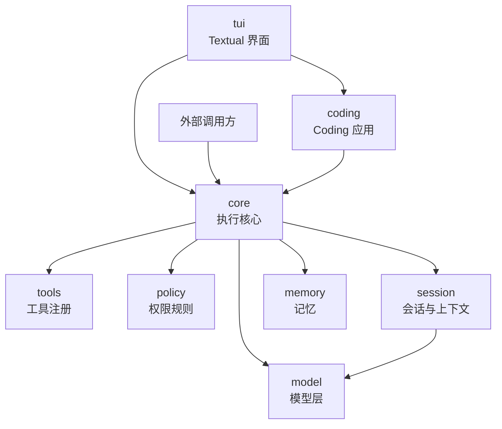

# v2 架构

术语以 [CONTEXT.md](../CONTEXT.md) 为准；已确定的设计决定记录在 [docs/adr](adr/)。v1 的实现说明归档在 [archive/v1/architecture.md](archive/v1/architecture.md)，v1 最终代码见 Git 标签 `v1-final`。

本文只规定模块边界、依赖方向、数据形态和行为契约，不描述函数内部实现。

## 1. 定位

AutoCoding Machine 是一个轻量、可组合的 Python Agent Framework。调用方提供模型、工具和业务规则，框架负责执行循环、权限审批、会话记录、上下文管理和运行事件。Coding CLI 是建立在框架上的一个应用，内置 `coding`、`review`、`companion` 三套 Profile。

### 不做的事

| 不做 | 原因 |
| --- | --- |
| 界面与核心之间的跨进程协议（JSON-RPC、ACP、HTTP） | 只有一个同进程的 Textual 界面；核心对外只暴露事件和方法调用，需要跨进程时在外层增加协议，核心不改 |
| 从 YAML 动态导入任意 Python 代码 | Profile 只选择已经安装的能力；自定义工具由 Python 调用方显式注册 |
| 操作系统级隔离 | 工作区路径限制和权限审批是应用层约束；需要隔离时由调用方使用容器或虚拟机 |
| 子代理、多代理协作、长任务编排 | 现有需求不需要；保留扩展点，不预先实现 |
| 异步公共接口 | 公共接口保持同步；界面在后台线程运行任务 |
| 会话分支 | 会话记录是线性追加的序列 |
| 插件市场与自动安装 | 能力通过 Python 依赖安装，通过 Profile 选择 |

## 2. 模块与依赖方向



**硬规则：依赖只能沿箭头方向。**`core` 及其下层模块不导入 `coding` 和 `tui`；`tools`、`policy`、`session`、`memory`、`model` 之间除图中箭头外互不导入。评审代码时逐条对照这条规则。

包结构：

```text
src/auto_coding_machine/
├── model/      模型层
├── tools/      工具注册
├── policy/     权限规则
├── session/    会话与上下文
├── memory/     记忆
├── core/       执行核心与公共入口
├── coding/     Coding 应用：代码工具、工作区、完成验证、提示词、内置 Profile
└── tui/        Textual 界面
```

### 模块职责

| 模块 | 负责 | 不负责 |
| --- | --- | --- |
| `model` | 发送请求、流式输出、统计用量、识别上下文超限，把服务端回复转换成 `AgentResponse` | 工具执行；界面显示 |
| `tools` | 工具的描述、参数校验、按名称执行、输出长度限制 | 判断能否执行 |
| `policy` | 根据工具名、参数和当前模式给出允许、询问或拒绝，并附带原因 | 弹窗；执行工具 |
| `session` | 追加写会话记录；把压缩摘要写成记录；恢复会话；修复中断留下的工具调用；计算上下文预算；组装每次模型请求；历史召回 | 业务规则；工具执行 |
| `memory` | 本地长期记忆的读写与容量限制；外部记忆的召回与写回契约；用户和团队作用域 | 决定何时注入，由 `session` 组装请求时决定 |
| `core` | 执行循环、工具批次、一次任务的生命周期（开始、暂停、恢复、取消）、事件分发、组装入口 | 任何界面显示；任何 Coding 专属规则 |
| `coding` | 代码工具、工作区路径限制、完成验证、Coding 提示词、内置 Profile，并通过扩展点注册到核心 | 循环本身 |
| `tui` | 显示事件、收集输入和审批决定、斜杠命令，把命令交给核心 | 直接读写会话文件或执行工具 |

## 3. 核心概念

[CONTEXT.md](../CONTEXT.md) 已定义的术语保持原义：事件、事件观察方、运行结果、工具批次、未执行回执、协作式取消、权限策略、权限请求、权限响应、权限决议事件、确认摘要、确认详情、宿主可见视图。v2 另外使用以下概念：

| 概念 | 含义 |
| --- | --- |
| Profile | 不可变配置：名称、类型、提示词、可用工具、权限规则、技能、预算和开关。只选择已经安装的能力 |
| 会话（Session） | 一段对话。原始记录由会话记录保存，进程内持有当前的模型视图 |
| 会话记录（Session Log） | 只追加的记录序列，是对话内容的唯一事实来源 |
| 任务（Run） | 一次用户输入从开始到结束的过程，可以暂停等待审批，可以取消 |
| 请求视图（Request View） | 每次调用模型前临时组装的消息列表：系统提示词、注入内容、会话历史和临时内容。不写回会话记录 |
| 权限规则（Permission Rule） | 一条匹配条件加一个决定。按优先级排序，第一条匹配的规则给出结果 |
| 完成检查（Completion Check） | 模型给出最终回答时由应用提供的检查，返回接受、继续或失败。Coding 的完成验证是它的一个实现 |
| 扩展点（Extension Point） | 核心为应用预留的固定接入位置，见第 6 节 |

## 4. 行为契约

完整规则见 [behavior-contracts.md](behavior-contracts.md)，共十组，每条附有 v1 中覆盖它的测试。v2 的测试按这些规则改写，全部通过才算 v2 完成。

以下几条决定了核心模块的形状，设计时优先满足：

- 一次模型回复中的工具调用按顺序处理；暂停审批后从同一位置继续，已执行的调用不重复执行。
- 每个工具调用都有回执：执行结果、拒绝原因、未执行回执或执行状态未知回执。
- 取消是协作式取消；审批期间取消后，随后到达的批准不执行工具。
- 权限决定只能提交一次；暂停和恢复不重置轮数预算。
- 工具回执或最终回复写入会话记录失败时，任务立刻以 `session_write_failed` 结束，不再执行任何操作。
- 上下文压缩不拆开工具调用和它的回执，也不改写已有的会话记录。
- 临时内容（历史召回、外部记忆、状态栏、验证提示）只进入本次请求，不写入会话记录。
- 事件观察方不能控制执行；对外只提供脱敏后的宿主可见视图。

## 5. 关键数据

### 会话记录类型

会话记录每行一条，每条有唯一 `id` 和 `type`。

| type | 内容 | 写入者 |
| --- | --- | --- |
| `user` | 用户输入；技能注入也以这种类型写入，并带来源标记 | `core` |
| `assistant` | 助手回复，可带工具调用列表 | `core` |
| `tool` | 工具回执：执行结果、拒绝原因、未执行回执或执行状态未知回执 | `core` |
| `compaction` | 压缩摘要文本，以及摘要之后保留的第一条记录的 `id` | `session` |

恢复会话时，从最近一条 `compaction` 记录开始：摘要加上它指向的记录及之后的全部记录，构成模型视图。压缩只追加 `compaction` 记录，不改写、不删除已有记录。`/clear` 只改变进程内视图。

验证提示等内部消息不写入会话记录。诊断记录（每次模型请求的完整输入输出、耗时）由可选的事件观察方写入单独文件，与会话记录分开。

### 运行结果

`run.start()` 与 `run.resolve_permission()` 返回同一种结果，按 `status` 区分：

| status | 附加字段 | 含义 |
| --- | --- | --- |
| `success` | `reply` | 模型给出最终回答 |
| `need_input` | `reply` | 模型给出普通文本但未表示完成，等待用户补充 |
| `permission_required` | `permission_request` | 任务暂停，等待宿主调用 `resolve_permission()` |
| `cancelled` | 无 | 协作式取消生效 |
| `failed` | `error`，可能有 `reply`、`tool_result` | `error` 取值：`max_turns`、`guard_stopped`、`no_tool_call`、`context_overflow`、`session_write_failed`、`verification_required` |

配置错误在任务开始前抛出 `ValueError` 或 `TypeError`；调用顺序错误（例如没有等待中的权限请求却提交决定）抛出 `RuntimeError`；未分类的模型、网络和自定义组件异常直接抛给调用方。

### 事件

事件只有一种订阅方式：观察方接收 `AgentEvent`，返回值不影响执行，观察方抛出的异常不中断任务。核心内部的状态统计、诊断记录与外部观察方使用同一种订阅方式。外部观察方收到的是宿主可见视图，原始工具参数、完整回执和消息列表不会离开核心。

| 事件 | 时机 |
| --- | --- |
| `pre_tool` | 权限检查通过、即将执行某个工具调用 |
| `post_tool` | 某个工具调用得到回执（包括拒绝和未执行） |
| `permission_required` | 任务暂停等待审批 |
| `permission_resolved` | 宿主提交了批准或拒绝；不代表工具执行成功 |
| `compacted` | 上下文完成一次压缩 |
| `compaction_fallback` | 摘要失败，改用确定性摘录；或上下文超限后强制压缩重试 |
| `completion_rejected` | 完成检查要求继续 |
| `done` / `need_input` / `failed` / `cancelled` | 任务结束，与运行结果的 `status` 一一对应 |

## 6. 扩展方式

外部调用方和应用只通过以下扩展点接入，扩展点之外的内部对象不属于公共接口。

| 扩展点 | 接入方式 | v1 中的实际使用者 |
| --- | --- | --- |
| 模型 | 传入 `model_fn(request_messages) -> AgentResponse`，或使用 `model` 模块的 `ModelAdapter` | Textual 界面、示例程序、测试 |
| 工具 | 实现工具协议（描述、参数、执行函数），注册到工具集合 | Coding 工具、订单示例的业务工具 |
| 权限规则 | 在 Profile 或调用方中追加规则；规则可以按参数判断 | Coding 的保护路径、记忆工具按动作区分 |
| 会话存储 | 实现 `session_id`、`load()`、`append()` 三个成员 | 默认 JSONL、测试中的内存存储 |
| 记忆 | 实现 `MemoryProvider.recall` 或 `MemoryWriter.capture`，并提供作用域 | 腾讯 Gateway Adapter |
| 完成检查 | 实现完成检查协议，由 Profile 启用 | Coding 完成验证 |
| 事件观察 | 打开会话时传入 `on_event` | Textual 界面 |

组装入口只有一个：`open_session(...)`。它根据 Profile 和调用方传入的覆盖项一次性创建全部组件，返回会话对象；会话创建任务，任务持有同一组组件。

## 7. 关键决定

| 决定 | 理由 | 参考 |
| --- | --- | --- |
| 核心不依赖任何应用；应用通过扩展点注册能力 | v1 的 `runtime` 直接导入 Coding 专属代码，Review、Companion 和外部调用方也被迫加载它们 | Qwen Code、Gemini CLI 的 core 包与 cli 包分离 |
| 权限只由 `policy` 模块判断，规则按优先级匹配 | v1 的保护路径、计划模式和工具规则分在三处，判断顺序依赖代码位置 | Gemini CLI 的规则引擎、OpenCode 的规则匹配、Claude Agent SDK 的检查顺序 |
| 压缩摘要写成会话记录 | v1 的压缩结果只在内存中，重启后丢失；写成记录后恢复会话可以从摘要继续，原始记录保持不变 | Qwen Code 的 `chat_compression` 记录、Pi 的 `compaction` 记录 |
| 审批是任务的暂停状态，由宿主显式提交决定 | 事件只通知、不控制执行，见 ADR 0001 | OpenAI Agents SDK 的 interruptions、OpenHands 的 `WAITING_FOR_CONFIRMATION` |
| `pre_tool` 只在权限检查通过后发出 | v1 先发出 `pre_tool` 再检查权限，完成验证因此会给随后被拒绝的调用拍修改前快照 | v1 代码审查 |
| 事件只保留一种订阅方式 | v1 同时有按名称订阅和 typed 事件订阅，按名称订阅只剩一个使用者 | Pi 的事件流、Kimi CLI 的 Wire 事件 |
| 模型连接只保留一份实现 | v1 的终端与无界面调用各有一份用量统计和流式处理 | Pi 的 `pi-ai`、Kimi 的 `kosong` |
| 组装只有一个入口和一个组件集合 | v1 的组件名称要经过六层传递，新增一个组件要改六处 | OpenHands SDK 的单一可变状态对象 |
